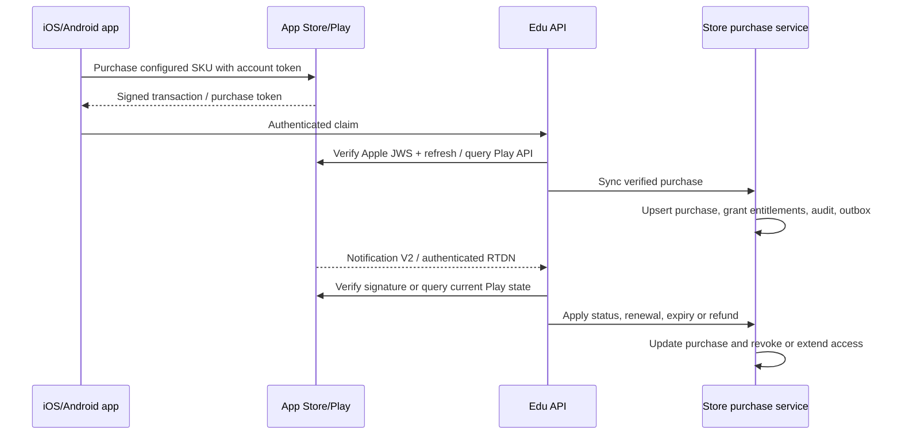

# In-app purchases: product to access

Apple and Google are merchant-of-record store channels. Their verified transactions live in `store_purchases`; they do **not** become locally issued `invoices` or `payment_records`. The store is the authority for what the customer was charged, including tax, conversion, refunds, and receipts. The local `Price` is an entitlement template and commercial catalog reference. An Apple transaction may include a currency and **milliunit** price; Google ProductPurchaseV2 does not provide a monetary amount. Never present the local price as the amount the store actually charged.

## Data model and ownership

| Question                            | Local record                                                                                                                                                |
| ----------------------------------- | ----------------------------------------------------------------------------------------------------------------------------------------------------------- |
| Which store SKU sells which offer?  | `store_product_mappings(provider, sku) -> prices.id`                                                                                                        |
| Which user owns the transaction?    | `store_purchases.account_id` after a verified store account token matches a bound financial account key                                                     |
| What was bought?                    | Immutable store provider, transaction ID, original transaction ID, SKU, mapped price ID, quantity, kind, environment and purchase time in `store_purchases` |
| Is access current?                  | Store purchase status and `entitlements.store_purchase_id`; the usual entitlement time and revocation checks apply                                          |
| What notifications arrived?         | Deduplicated `store_notifications(provider, event_id, type, purchase_id, occurred_at)` plus audit and outbox                                                |
| Was an order voided before a claim? | `store_voids(provider, transaction_id, token_hash, event_id, occurred_at)` prevents a later grant for that order                                            |

The provider transaction ID is unique per store; the token hash links Google RTDN to existing purchases without retaining the raw purchase token. Apple original transaction IDs connect renewals and restores; Google subscription order IDs distinguish renewal purchases, while a SHA-256 purchase-token hash connects the subscription chain. A mapped SKU cannot be reassigned to another local price. Retire the old SKU and create a new store listing and mapping when the entitlement offer changes.

## Prepare a product

Create an entitlement definition, product and price as in [catalog and pricing](./catalog-and-pricing.md). Then map the exact App Store Connect or Play Console SKU to that price:

```ts
const store = createStorePurchaseService({
  repository: db.storePurchases,
  transactions: db.storePurchaseTransactions,
});
await store.mapProduct({
  actor: financialManager,
  audit,
  provider: "apple", // or "google"
  sku: "course.gold",
  priceId: price.id,
});
```

The price frequency must be `one_time` for a consumable/non-consumable or recurring for an auto-renewing subscription. A store SKU must have one line item; multi-product Play orders and Apple Advanced Commerce bundles require a separate mapping design and are rejected here. The service rejects inactive, blocked or unmapped new offers. Existing mapped purchases can still receive a refund notification after an offer is retired.

## Bind the store identity before checkout

Generate a stable, random UUID per app account for Apple. Bind `iap.apple.<uuid>` to the financial account with `financial.bindAccountKey`, then pass that UUID as StoreKit `appAccountToken` during the purchase. For Google, derive a stable, non-reversible obfuscated account ID in the host (for example, an HMAC of the internal user ID with a host secret), bind `iap.google.<id>`, and pass the ID to BillingFlowParams `setObfuscatedAccountId`. The store account ID is never taken from the device as proof of ownership; it must appear in the verified Apple transaction or Play API result and match the existing binding.

```ts
await financial.bindAccountKey({
  actor: managerFor(userId),
  audit,
  userId,
  key: `iap.apple.${appAccountToken}`,
});
```

Without a matching binding, a valid store transaction is saved **unclaimed** and grants no access. A client cannot claim another account's transaction. Apple's Family Sharing transactions are rejected by this adapter because their `appAccountToken` may be absent and a separate beneficiary ownership model is needed. Do not use a raw user ID as Google's obfuscated account ID.

## Purchase, claim and webhook sequence



The app submits a StoreKit signed transaction to `POST /v1/store-purchases/apple/claim` or a Play purchase token and `kind` (`one_time` or `subscription`) to `POST /v1/store-purchases/google/claim`. Both routes require the host's authenticated `financial:purchase` principal. The host resolves that principal to a user ID; it never accepts a user ID in the claim body. Apple verifies the JWS against Apple's root certificates and app identity, then refreshes transaction info through the App Store Server API. Google queries ProductPurchaseV2 or SubscriptionPurchaseV2 using server credentials. Pending purchases produce no grant. A successful local transaction and Google acknowledgement are separate steps: if acknowledgement fails, the request fails so the app or RTDN can retry; the duplicate local sync is safe.

Configure `/v1/webhooks/apple-app-store` for App Store Server Notifications **V2** and `/v1/webhooks/google-play` as an authenticated Pub/Sub push endpoint. Apple verifies the outer notification JWS and nested transaction JWS. Google verifies the push JWT's signature, audience and service-account email, then queries Play; the RTDN body itself is only a change signal. A successful response means the event was durably recorded. Both routes are registered only when their provider adapter is injected into `createApiServer`. See the dedicated [Apple setup](./setup-apple-app-store.md) and [Google setup](./setup-google-play.md).

## Lifecycle and refunds

- Each verified transaction or renewal order creates one `store_purchases` row. Replays do not duplicate entitlements. An active subscription grant ends at the verified store expiry. A later renewal creates the next period; an extension to the same transaction creates only the additional period.
- A store refund or full void marks that transaction permanently revoked and revokes grants linked to it. A later stale purchase query cannot silently restore it. Apple's signed `REFUND_REVERSED` can reinstate its grants. Store cancellations that retain an active paid period keep access through the store expiry.
- Google account hold or pause suspends access; a verified recovery can restore it. Grace period retains access through the store expiry. Apple `DID_FAIL_TO_RENEW` without grace and `GRACE_PERIOD_EXPIRED` remove access.
- Google full voids identify the exact stored order ID and purchase-token hash, including an older subscription renewal order, and revoke only that order's grants. The order is tombstoned first, so a full void that arrives before the client claim cannot later grant access. A full void for an unknown order, a quantity-based **partial** void, or a pending refund review emits `financial.store-notification.review_required`. These require manual/provider reconciliation; this implementation does not guess which portion of a metered grant to reverse.
- Apple and Google own customer refunds and tax receipts. This integration records refund state and access changes, but does not initiate store refunds, issue local credit notes, calculate store tax, or store card/payment-method details.

The authenticated `GET /v1/store-purchases?limit=25&cursor=...` returns `{ data, pagination, links }` with no raw purchase token, signed JWS, provider credential or account token. The response is `no-store`. To answer “what was paid for?”, use the row's store, SKU, mapped price and transaction ID, then reconcile monetary detail against the store's own order/finance reports. `entitlements.store_purchase_id` shows exactly which access that purchase created. Web, Stripe and PowerTranz sales continue to use [invoice lines and payment records](./purchase-flow.md).

## Host composition

```ts
const stores = readStoreProviderConfiguration(process.env, operationLog);
const storeService = createStorePurchaseService({
  repository: db.storePurchases,
  transactions: db.storePurchaseTransactions,
});
await createApiServer({
  storePurchases: {
    service: storeService,
    apple: stores.apple ?? undefined,
    google: stores.google ?? undefined,
    authenticator,
    resolveUserId: (principal) => userIdForPrincipal(principal),
    webhookActor: trustedFinancialAgent,
  },
});
```

The host must provision product mappings and account bindings, surface store purchase status to the app, deliver the transactional outbox, and run periodic reconciliation for missed notifications. The package does not start a worker or create store catalog products. The adapters log `financial.provider.unavailable` when their configuration is absent; do not expose a claim or webhook route for an unconfigured provider.
