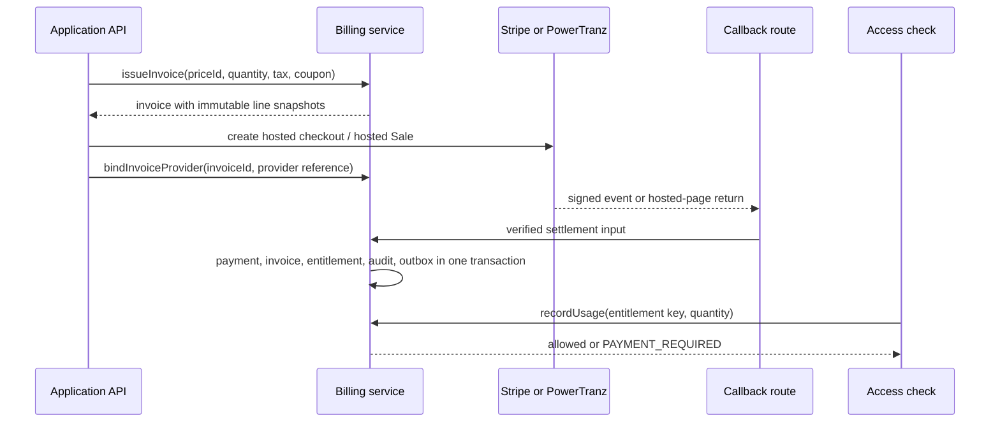

# How a product purchase becomes access

This guide is the reference flow for a developer adding a “buy product” button. It explains which records prove what the customer bought, how a provider notification is connected to that purchase, and when the application may allow access.

The short rule is: a `Product` describes the sellable capability, a `Price` describes the commercial offer, an `Invoice` snapshots the selected offer, a `PaymentRecord` proves a verified settlement, and `Entitlement` rows are the access granted by that settlement. Never grant access from a browser success URL.



## 1. Configure the catalog before anyone can buy

Create stable entitlement definitions first, then create the product and one or more prices. A price maps to the entitlement keys and quantities it grants. For example, `ai-pro-monthly-usd` can map `ai.chat.request` to `2000n`, while a higher price maps the same key to `null` for unlimited access.

```ts
await financial.registerEntitlementDefinition({
  key: "course.lesson.access",
  description: "Access to one course lesson",
  unit: "boolean",
  resetStrategy: "never",
  resetIntervalSeconds: null,
});

const product = await billing.createProduct({
  actor: manager,
  audit,
  key: "course-typescript",
  name: "TypeScript Course",
  riskLevel: "low",
});

const price = await billing.createPrice({
  actor: manager,
  audit,
  productId: product.id,
  currency: "USD",
  unitAmountMinor: 4900n,
  frequency: "one_time",
  intervalCount: 1,
  trialDays: 0,
  entitlements: [{ key: "course.lesson.access", quantity: null }],
});
```

The price is the source of the entitlement mapping. Do not put a product key or arbitrary feature list in the checkout request and then grant it later. If the offer changes, retire the price and create another one.

## 2. Issue the local invoice before starting payment

When a customer chooses a price, issue an invoice using an idempotency key generated for that attempted purchase. The manager actor must act on behalf of the customer. The service validates that the product and price are active and not blocked, applies a valid coupon, and copies the price into immutable invoice lines.

```ts
const invoice = await billing.issueInvoice({
  actor: managerFor(userId),
  audit,
  userId,
  idempotencyKey: `checkout:${requestId}`,
  couponCode: "WELCOME10",
  lines: [
    {
      priceId: price.id,
      quantity: 1n,
      taxRateBps: 750,
    },
  ],
});
```

The invoice is the durable answer to “what did they buy?” Read `invoice.lines` to obtain the product ID, price ID, name snapshot, quantity, unit price, discount, tax, total, and optional service dates. It remains correct even if the catalog price changes later.

| Question                        | Authoritative local record                                                   |
| ------------------------------- | ---------------------------------------------------------------------------- |
| What did the customer select?   | `invoice_lines.product_id`, `price_id`, `description`, and `quantity`        |
| What did it cost?               | Invoice and line `*_minor` amounts plus `currency`                           |
| What discount/tax was used?     | Invoice and line discount/tax snapshots; `coupon_redemptions` for the coupon |
| Which provider attempt pays it? | `invoices.provider` and `provider_reference`                                 |
| Was it settled?                 | `payment_records` and `invoices.status = paid`                               |
| What access did it create?      | `entitlements.invoice_id = invoice.id`                                       |

## 3. Start hosted payment and bind the provider reference

### Stripe Checkout

Create the Checkout session from the **invoice total**, then bind the returned session ID. Use the local invoice ID or a unique checkout key as the Stripe idempotency key. Keep the browser success/cancel URLs for UI navigation only.

```ts
const checkout = await stripe.createOneOffCheckout({
  amount: { currency: invoice.currency, amountMinor: invoice.totalMinor },
  accountKey: accountKey,
  idempotencyKey: `stripe:${invoice.id}`,
  description: invoice.lines.map((line) => line.description).join(", "),
  successUrl: "https://app.example.com/purchase/success",
  cancelUrl: "https://app.example.com/purchase/cancel",
});

await billing.bindInvoiceProvider({
  actor: managerFor(userId),
  audit,
  userId,
  invoiceId: invoice.id,
  provider: "stripe",
  providerReference: checkout.providerReference, // Checkout session ID
});

return { checkoutUrl: checkout.checkoutUrl };
```

Do not call `recordPayment` after the browser reaches `successUrl`. Stripe may still have an asynchronous method, an incomplete payment, or a forged navigation request.

### PowerTranz hosted Sale

Pass the issued invoice to `createPowerTranzCheckout.begin`. It validates that the invoice belongs to the user, binds a new PowerTranz transaction ID, stores only a hash of the SPI token, and returns `redirectData` for the provider iframe.

```ts
const started = await powerTranzCheckout.begin({
  actor: managerFor(userId),
  audit,
  userId,
  invoiceId: invoice.id,
  merchantResponseUrl: "https://api.example.com/v1/webhooks/powertranz",
  threeDSecure: true,
});

return {
  transactionIdentifier: started.transactionIdentifier,
  redirectData: started.redirectData,
  expiresAt: started.expiresAt,
};
```

The PowerTranz return comes through the cardholder browser, so it is not a trusted payment statement. The callback route matches the stored token hash and only settles after the server-side `/spi/Payment` result is approved and matches the invoice identifiers, currency, and amount.

## 4. Let the verified callback settle the invoice

Mount the provider routes at application composition time. The supplied trusted actor is the provider-sync service identity; it acts for the user only after the local invoice match is established.

```ts
await createApiServer({
  stripeWebhook: {
    verifier: stripe,
    actor: providerSyncAgent,
    sync: {
      applyProviderEvent: (input) =>
        billing.applyProviderEvent({
          ...input,
          dunningSchedule: {
            delaysSeconds: [3600, 86400],
            graceSeconds: 172800,
          },
          revokeOnFullRefund: true,
        }),
    },
  },
  powerTranzCallback: { checkout: powerTranzCheckout },
});
```

For Stripe, `/v1/webhooks/stripe` verifies the raw-body signature and timestamp before parsing. A matched `checkout.session.completed` only fulfills when it is paid and its session ID, payment intent, amount, and currency match the bound invoice. It stores the provider event ID to make duplicate delivery a no-op.

For PowerTranz, `/v1/webhooks/powertranz` accepts only the bounded form return. It never considers the form proof of payment. The checkout service completes the SPI transaction server to server, and then calls the same local payment flow.

Settlement writes the following in one database transaction:

1. A unique `payment_records` row.
2. `invoices.status = paid` and `paid_at` once the invoice is fully paid.
3. One `entitlements` row for every mapping on every paid invoice line.
4. Audit events and outbox events, including `financial.payment.recorded`, `financial.invoice.paid_local`, entitlement events, and `financial.fulfillment.completed`.

A partial payment remains an open invoice and creates no entitlement. A duplicate webhook cannot add a second payment or grant because provider event IDs and provider payment references are unique.

## 5. Use the entitlement to enforce access

Application features check and consume the entitlement key, not the provider reference or product label. For metered access, record usage with an idempotency key. The financial service calculates the active allowance in the definition’s UTC reset window.

```ts
await financial.recordUsage({
  actor: { kind: "user", userId },
  audit,
  userId,
  entitlementKey: "ai.chat.request",
  quantity: 1n,
  idempotencyKey: requestId,
});
```

If access is unavailable or exhausted, this throws `DomainError("PAYMENT_REQUIRED")`. Its details include the entitlement key and, when exactly one active price supplies the key, the corresponding `productId` and `priceId`. Use that to present a purchase offer; do not trust a price ID supplied by the browser without looking it up.

For a non-metered course or feature, use the same entitlement data for an authorization check. The application must treat a grant as active only when it has started, has not ended, and has not been revoked.

## Reading purchase history

Start with the financial account for the user, then query invoices by account and their lines. From an invoice, query payments, refunds, credit notes, dunning attempts, and entitlements by invoice ID. This gives support and product code a complete timeline without reconstructing money from today’s catalog.

```text
financial_account
  └─ invoice
       ├─ invoice_lines       ← product/price and commercial snapshot
       ├─ payment_records     ← confirmed provider settlement
       │    └─ refund_records ← confirmed refunds
       ├─ credit_notes        ← correction record
       ├─ dunning_attempts    ← collection failures
       └─ entitlements        ← access created by this invoice
```

Provider data is reconciliation evidence; the local invoice, payment, and entitlement tables are the application's access evidence. Do not remove historical records when a product is retired, a payment method is detached, or a refund is issued.

## Failure cases developers must handle

- A customer cancels or abandons checkout: retain the open invoice for reconciliation or expire it under host policy; grant nothing.
- A payment fails or requires SCA/3DS action: record dunning, guide the customer back to the provider, and do not revoke an already-paid period automatically.
- A webhook is duplicated or arrives after another one: the transaction is idempotent. Return success to the provider; do not manually retry fulfillment.
- The provider callback cannot be matched to a local invoice: retain the provider event for reconciliation and investigate. Never attach it based on a user-controlled identifier.
- A full confirmed refund: create the credit note and, if configured through `revokeOnFullRefund`, revoke entitlements tied to that invoice.

See [invoices](./invoices.md), [provider webhooks](./provider-webhooks.md), [PowerTranz](./powertranz.md), and [published events](./events.md) for the detailed contracts.

For App Store and Play purchases, use the [in-app purchase flow](./in-app-purchases.md). Those sales have store transaction and entitlement records instead of locally issued invoices and payment records.
